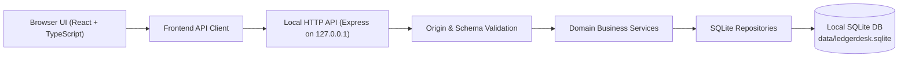

# LedgerDesk — Technical Architecture

## 1. Architectural Pattern

LedgerDesk uses a **Modular Monolithic Architecture** running locally on the user's machine. It separates presentation, HTTP transport, business logic, and SQLite persistence into distinct, testable layers without microservice overhead.



---

## 2. Technology Stack

### Frontend
- **Framework:** React 19 + TypeScript
- **Bundler / Dev Environment:** Vite (serving local bundles with zero external CDN requests)
- **Routing:** State/URL-synchronized client router (`react-router-dom` or lightweight history router) supporting deep-linking between Dashboard, Transactions, Accounts, Budgets, Recurring Payments, Savings Goals, Reports, and Settings
- **Styling:** Standard CSS with custom properties (neutral desktop financial aesthetic, high-contrast typography, tabular numerals `font-variant-numeric: tabular-nums`)
- **Charts:** Custom locally rendered SVG chart components (bar charts, stacked comparison bars, horizontal category distribution bars, progress meters) — zero external network requests, deterministic rendering, and full testability in JSDOM
- **Icons:** Inline SVG icon system bundled directly in source code

### Backend
- **Runtime:** Node.js (v22+ / v26 native support) with TypeScript (`tsx` for local execution, `tsc` for typechecking/build)
- **HTTP Framework:** Express bound strictly to `127.0.0.1` by default (`HOST=127.0.0.1`)
- **Validation:** Shared schema and domain validators (`zod` + custom domain financial validators) enforcing strict types, calendar dates, and integer minor units

### Database
- **Engine:** SQLite via Node.js built-in `node:sqlite` (`DatabaseSync`, `StatementSync`, and `backup`)
- **Integrity Features:**
  - `PRAGMA foreign_keys = ON` (`enableForeignKeyConstraints: true`)
  - `PRAGMA journal_mode = WAL` for concurrent read/write reliability
  - Explicit `BEGIN IMMEDIATE ... COMMIT / ROLLBACK` transaction wrappers for multi-step writes
  - Versioned deterministic SQL migrations tracked in `schema_migrations`
  - Online backup via `node:sqlite` `backup()` API with atomic verification before restore

### Testing
- **Test Runner:** Vitest
- **UI Testing:** React Testing Library + `@testing-library/jest-dom` + `jsdom`
- **API & Integration Testing:** `supertest` against the Express application backed by isolated temporary SQLite databases

---

## 3. Layer Responsibilities

### 3.1 Frontend (`src/client/`)
- Renders views, accessible forms, data tables, SVG charts, and confirmation modals.
- Converts user-entered decimal strings (e.g. `"125.50"`) into integer minor units (`12550`) using shared deterministic conversion utilities before sending to the API, and formats integer minor units back into human-readable currency strings for display.
- **Never** computes authoritative account balances or report aggregations independently; always displays figures computed and returned by the backend services.

### 3.2 HTTP API & Middleware (`src/server/routes/`, `src/server/middleware/`)
- Enforces security headers (restrictive Content Security Policy, `X-Content-Type-Options: nosniff`, `X-Frame-Options: DENY`).
- Enforces local origin validation to block cross-site request forgery from external websites when the user's browser is open.
- Parses and validates request bodies and query parameters before invoking business services.
- Maps domain errors (`ValidationError`, `NotFoundError`, `ConflictError`) into structured JSON responses (`{ error: { code, message, details } }`) without leaking raw SQL or stack traces.

### 3.3 Business Services (`src/server/services/`)
Dedicated services encapsulate all financial rules:
- `SettingsService`: Application settings (`base_currency`, `date_format`, etc.).
- `AccountService`: Account creation, updates, archiving, deletion checks, and ledger-derived balance computation.
- `CategoryService`: Income/expense categories, hierarchy/ordering, archiving, and safe reassignment.
- `TransactionService`: Creation, editing, soft-deletion (trash), restoration, duplication, transfer validation, refund linking, filtering, and pagination.
- `BudgetService`: Monthly category budgets, eligible spending calculation (including linked refund reduction and transfer exclusion), remaining/overspent computation, and historical budget performance.
- `RecurringService`: Recurring schedule management, deterministic next-due-date calculation, idempotent occurrence generation (`recurring_occurrences`), and atomic confirmation that posts a real ledger transaction.
- `GoalService`: Savings goal lifecycle, manual or transaction-linked contributions, and progress calculation without double-deducting account balances.
- `ReportService`: Dashboard summaries, period resolution, cash-flow series, category breakdowns, account summaries, budget reports, and CSV formatting.
- `ImportExportService`: CSV parsing, column mapping preview, row-level validation, duplicate detection against existing transactions, atomic batch commit, CSV export, and full structured JSON export.
- `BackupService`: Safe SQLite backup creation, backup metadata listing, backup file integrity verification (`PRAGMA integrity_check` and required table checks), and atomic restore with automatic pre-restore safety snapshot.

### 3.4 Repositories & Database (`src/server/repositories/`, `src/server/domain/`)
- Encapsulate prepared SQL statements and row-to-domain mapping.
- Provide a `withTransaction(db, fn)` helper to guarantee atomicity across multi-table operations.

---

## 4. Directory Structure

```text
ledgerdesk/
├── package.json
├── tsconfig.json
├── vite.config.ts
├── README.md
├── .gitignore
├── docs/
│   ├── PROJECT_VISION.md
│   ├── ARCHITECTURE.md
│   ├── DATA_MODEL.md
│   ├── FINANCIAL_RULES.md
│   ├── PRIVACY_AND_SECURITY.md
│   ├── IMPLEMENTATION_PLAN.md
│   └── TEST_PLAN.md
├── database/
│   ├── migrations/
│   │   └── 001_initial_schema.sql
│   └── seed/
│       └── default_categories.ts
├── data/
│   ├── .gitkeep
│   └── backups/
│       └── .gitkeep
├── src/
│   ├── shared/
│   │   ├── constants/
│   │   ├── schemas/
│   │   ├── types/
│   │   └── utils/
│   │       ├── money.ts
│   │       └── dates.ts
│   ├── server/
│   │   ├── app.ts
│   │   ├── server.ts
│   │   ├── db/
│   │   │   ├── connection.ts
│   │   │   └── migrator.ts
│   │   ├── errors/
│   │   ├── middleware/
│   │   ├── repositories/
│   │   ├── services/
│   │   └── routes/
│   └── client/
│       ├── index.html
│       ├── main.tsx
│       ├── app/
│       │   ├── App.tsx
│       │   └── navigation.ts
│       ├── components/
│       │   ├── layout/
│       │   ├── forms/
│       │   ├── tables/
│       │   ├── charts/
│       │   ├── dialogs/
│       │   └── feedback/
│       ├── features/
│       │   ├── dashboard/
│       │   ├── transactions/
│       │   ├── accounts/
│       │   ├── categories/
│       │   ├── budgets/
│       │   ├── recurring/
│       │   ├── goals/
│       │   ├── reports/
│       │   ├── imports/
│       │   └── settings/
│       ├── services/
│       │   └── apiClient.ts
│       └── styles/
│           └── main.css
└── tests/
    ├── unit/
    ├── integration/
    ├── api/
    ├── ui/
    └── fixtures/
```
