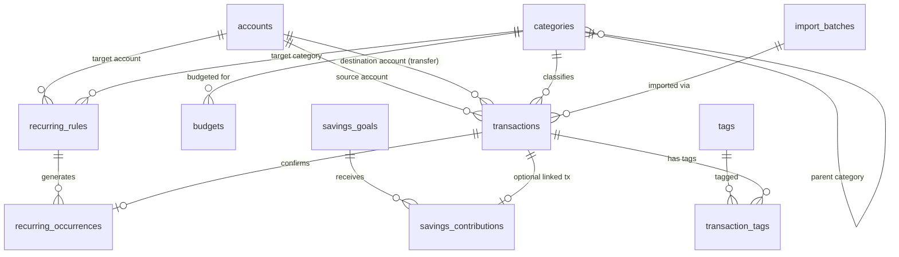

# LedgerDesk — Database Design & Data Model

## 1. Storage Engine & Conventions

- **Engine:** SQLite 3 (via Node.js `node:sqlite`)
- **Primary Keys:** Text UUIDs (`id TEXT PRIMARY KEY`) or natural string keys (`setting_key`, `version`) for deterministic client/server references and clean JSON export/import portability.
- **Monetary Columns:** Stored as `INTEGER NOT NULL` representing minor units (e.g., cents: `10000` = `100.00`).
- **Calendar Dates:** Stored as `TEXT NOT NULL` in strict ISO calendar format `YYYY-MM-DD`.
- **Timestamps:** Stored as `TEXT NOT NULL` in ISO-8601 UTC format (`YYYY-MM-DDTHH:mm:ss.sssZ`).
- **Foreign Keys:** Enforced at connection initialization via `enableForeignKeyConstraints: true` (`PRAGMA foreign_keys = ON`).

---

## 2. Entity-Relationship Overview

---

## 3. Schema Specification

### 3.1 `schema_migrations`
Tracks applied SQL migrations in deterministic order.
- `version TEXT PRIMARY KEY` (e.g., `'001_initial_schema'`)
- `applied_at TEXT NOT NULL`

### 3.2 `app_settings`
Key-value store for global application preferences.
- `setting_key TEXT PRIMARY KEY`
- `setting_value TEXT NOT NULL`
- `updated_at TEXT NOT NULL`

Default seeded settings:
- `base_currency`: `'USD'`
- `date_format`: `'YYYY-MM-DD'`
- `default_period`: `'this_month'`

### 3.3 `accounts`
Represents user-managed financial accounts.
- `id TEXT PRIMARY KEY`
- `name TEXT NOT NULL UNIQUE`
- `account_type TEXT NOT NULL CHECK (account_type IN ('cash', 'current', 'savings', 'credit_card', 'other'))`
- `opening_balance_minor INTEGER NOT NULL DEFAULT 0`
- `currency TEXT NOT NULL DEFAULT 'USD'`
- `description TEXT NOT NULL DEFAULT ''`
- `status TEXT NOT NULL DEFAULT 'active' CHECK (status IN ('active', 'archived'))`
- `created_at TEXT NOT NULL`
- `updated_at TEXT NOT NULL`

### 3.4 `categories`
Stores income and expense classifications.
- `id TEXT PRIMARY KEY`
- `name TEXT NOT NULL`
- `category_type TEXT NOT NULL CHECK (category_type IN ('income', 'expense'))`
- `parent_id TEXT REFERENCES categories(id) ON DELETE SET NULL`
- `display_order INTEGER NOT NULL DEFAULT 0`
- `is_archived INTEGER NOT NULL DEFAULT 0 CHECK (is_archived IN (0, 1))`
- `created_at TEXT NOT NULL`
- `updated_at TEXT NOT NULL`
- `UNIQUE(name, category_type)`

### 3.5 `transactions`
Central financial ledger.
- `id TEXT PRIMARY KEY`
- `transaction_type TEXT NOT NULL CHECK (transaction_type IN ('income', 'expense', 'transfer', 'refund'))`
  *(Note: Refunds can either be recorded as `expense` with `is_refund = 1` or linked via `refunded_transaction_id`; see Section 3.5 constraints below.)*
- `transaction_date TEXT NOT NULL` (`YYYY-MM-DD`)
- `amount_minor INTEGER NOT NULL CHECK (amount_minor > 0)`
- `currency TEXT NOT NULL DEFAULT 'USD'`
- `account_id TEXT NOT NULL REFERENCES accounts(id) ON DELETE RESTRICT`
- `destination_account_id TEXT REFERENCES accounts(id) ON DELETE RESTRICT`
- `category_id TEXT REFERENCES categories(id) ON DELETE RESTRICT`
- `description TEXT NOT NULL DEFAULT ''`
- `notes TEXT NOT NULL DEFAULT ''`
- `is_refund INTEGER NOT NULL DEFAULT 0 CHECK (is_refund IN (0, 1))`
- `refunded_transaction_id TEXT REFERENCES transactions(id) ON DELETE SET NULL`
- `import_batch_id TEXT REFERENCES import_batches(id) ON DELETE SET NULL`
- `import_external_id TEXT`
- `created_at TEXT NOT NULL`
- `updated_at TEXT NOT NULL`
- `deleted_at TEXT` (NULL when active; ISO timestamp when in trash / soft-deleted)

**Database-level integrity constraints on `transactions`:**
1. For `transfer`: `destination_account_id IS NOT NULL AND destination_account_id != account_id AND category_id IS NULL AND is_refund = 0`
2. For `income` and `expense`: `destination_account_id IS NULL AND category_id IS NOT NULL`
3. `is_refund = 1` is only valid when `transaction_type = 'expense'` (representing a refund credited back to an expense category and account) or when `transaction_type = 'income'`. Specifically, in LedgerDesk, a refund is stored with `transaction_type = 'expense'`, `is_refund = 1`, `amount_minor > 0`, which **increases** the account balance and **reduces** net spending in that expense category without inflating gross income!

### 3.6 `tags` & `transaction_tags`
Normalized tag storage for flexible filtering.
- `tags`:
  - `id TEXT PRIMARY KEY`
  - `name TEXT NOT NULL UNIQUE`
  - `created_at TEXT NOT NULL`
- `transaction_tags`:
  - `transaction_id TEXT NOT NULL REFERENCES transactions(id) ON DELETE CASCADE`
  - `tag_id TEXT NOT NULL REFERENCES tags(id) ON DELETE CASCADE`
  - `PRIMARY KEY (transaction_id, tag_id)`

### 3.7 `budgets`
Stores monthly spending limits (`YYYY-MM`).
- `id TEXT PRIMARY KEY`
- `name TEXT NOT NULL`
- `category_id TEXT REFERENCES categories(id) ON DELETE RESTRICT` *(NULL allowed if representing an overall total monthly budget; `UNIQUE(category_id, period_month)` enforced via indexes)*
- `period_month TEXT NOT NULL` (`YYYY-MM`)
- `planned_amount_minor INTEGER NOT NULL CHECK (planned_amount_minor > 0)`
- `notes TEXT NOT NULL DEFAULT ''`
- `status TEXT NOT NULL DEFAULT 'active' CHECK (status IN ('active', 'archived'))`
- `created_at TEXT NOT NULL`
- `updated_at TEXT NOT NULL`

### 3.8 `recurring_rules`
Defines recurring income or expense schedules.
- `id TEXT PRIMARY KEY`
- `name TEXT NOT NULL`
- `transaction_type TEXT NOT NULL CHECK (transaction_type IN ('income', 'expense'))`
- `amount_minor INTEGER NOT NULL CHECK (amount_minor > 0)`
- `account_id TEXT NOT NULL REFERENCES accounts(id) ON DELETE RESTRICT`
- `category_id TEXT NOT NULL REFERENCES categories(id) ON DELETE RESTRICT`
- `description TEXT NOT NULL DEFAULT ''`
- `frequency TEXT NOT NULL CHECK (frequency IN ('daily', 'weekly', 'monthly', 'yearly'))`
- `interval_count INTEGER NOT NULL DEFAULT 1 CHECK (interval_count >= 1)`
- `start_date TEXT NOT NULL` (`YYYY-MM-DD`)
- `end_date TEXT` (`YYYY-MM-DD` or NULL)
- `next_due_date TEXT NOT NULL` (`YYYY-MM-DD`)
- `status TEXT NOT NULL DEFAULT 'active' CHECK (status IN ('active', 'paused', 'cancelled'))`
- `created_at TEXT NOT NULL`
- `updated_at TEXT NOT NULL`

### 3.9 `recurring_occurrences`
Tracks materialized occurrences for recurring rules.
- `id TEXT PRIMARY KEY`
- `recurring_rule_id TEXT NOT NULL REFERENCES recurring_rules(id) ON DELETE CASCADE`
- `due_date TEXT NOT NULL` (`YYYY-MM-DD`)
- `expected_amount_minor INTEGER NOT NULL CHECK (expected_amount_minor > 0)`
- `status TEXT NOT NULL DEFAULT 'pending' CHECK (status IN ('pending', 'confirmed', 'skipped'))`
- `linked_transaction_id TEXT REFERENCES transactions(id) ON DELETE SET NULL`
- `created_at TEXT NOT NULL`
- `updated_at TEXT NOT NULL`
- `UNIQUE (recurring_rule_id, due_date)` — guarantees idempotency so repeated runs never duplicate an occurrence for the same rule and due date.

### 3.10 `savings_goals`
Stores user financial goals.
- `id TEXT PRIMARY KEY`
- `name TEXT NOT NULL UNIQUE`
- `target_amount_minor INTEGER NOT NULL CHECK (target_amount_minor > 0)`
- `target_date TEXT` (`YYYY-MM-DD` or NULL)
- `account_id TEXT REFERENCES accounts(id) ON DELETE SET NULL` (optional reference account for display/tracking)
- `description TEXT NOT NULL DEFAULT ''`
- `status TEXT NOT NULL DEFAULT 'active' CHECK (status IN ('active', 'completed', 'archived'))`
- `created_at TEXT NOT NULL`
- `updated_at TEXT NOT NULL`

### 3.11 `savings_contributions`
Stores contributions toward a savings goal.
- `id TEXT PRIMARY KEY`
- `goal_id TEXT NOT NULL REFERENCES savings_goals(id) ON DELETE CASCADE`
- `amount_minor INTEGER NOT NULL CHECK (amount_minor != 0)` (positive for contribution, negative for withdrawal from goal allocation)
- `contribution_date TEXT NOT NULL` (`YYYY-MM-DD`)
- `linked_transaction_id TEXT REFERENCES transactions(id) ON DELETE SET NULL`
- `notes TEXT NOT NULL DEFAULT ''`
- `created_at TEXT NOT NULL`

### 3.12 `import_batches`
Tracks CSV import executions.
- `id TEXT PRIMARY KEY`
- `source_filename TEXT NOT NULL`
- `import_date TEXT NOT NULL`
- `account_id TEXT NOT NULL REFERENCES accounts(id) ON DELETE RESTRICT`
- `status TEXT NOT NULL CHECK (status IN ('completed', 'failed'))`
- `imported_count INTEGER NOT NULL DEFAULT 0`
- `skipped_count INTEGER NOT NULL DEFAULT 0`
- `error_count INTEGER NOT NULL DEFAULT 0`

---

## 4. Indexes

The initial migration creates indexes on:
- `idx_transactions_date` on `transactions(transaction_date)`
- `idx_transactions_account` on `transactions(account_id)`
- `idx_transactions_dest_account` on `transactions(destination_account_id)`
- `idx_transactions_category` on `transactions(category_id)`
- `idx_transactions_deleted` on `transactions(deleted_at)`
- `idx_budgets_period_category` on `budgets(period_month, category_id)`
- `idx_recurring_occurrences_status_due` on `recurring_occurrences(status, due_date)`
- `idx_savings_contributions_goal` on `savings_contributions(goal_id)`
